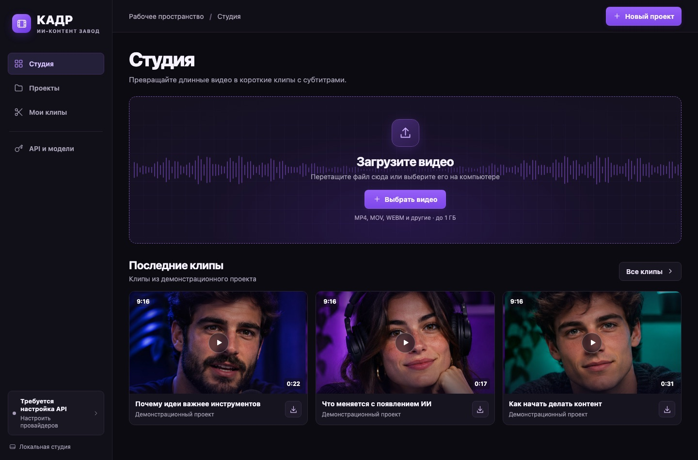

# КАДР

[](https://github.com/g0nya/kadr-content-factory/actions/workflows/check.yml)

КАДР — локальная ИИ-студия, которая превращает длинное видео с речью в короткие клипы. Загрузите запись, выберите настройки и скачайте MP4 из браузера.



## Возможности

- Поиск удачных моментов по расшифровке речи. До пяти клипов на проект, вертикальный формат 9:16 или исходные пропорции.
- Субтитры с таймкодами, перевод и скачивание SRT.
- ИИ-озвучка исходного текста или перевода. Исходный звук можно оставить тихим фоном.
- Заголовок, описание и хэштеги для YouTube Shorts, Instagram Reels, TikTok или VK Клипов.
- Независимый выбор провайдера и модели для каждой задачи, включая Ollama, Hermes Agent, OpenClaw и свой OpenAI-совместимый сервер.

## Быстрый запуск

Нужны **Node.js 22+**, **FFmpeg** с `libx264` и **FFprobe**. У проекта нет зависимостей npm.

```sh
git clone https://github.com/g0nya/kadr-content-factory.git
cd kadr-content-factory
npm start
```

Откройте [студию на localhost](http://127.0.0.1:4173/). На macOS также можно запустить `Запустить.command`.

1. В [«API и модели»](http://127.0.0.1:4173/#settings) сохраните настройки «Распознавание речи» и «Поиск моментов». Добавьте API перевода, озвучки или публикации по необходимости.
2. Загрузите видео с аудиодорожкой. Приложение принимает файлы до 1 ГБ длительностью от 2 секунд до 60 минут.
3. Выберите формат, число клипов, субтитры и озвучку. Перевод и текст для публикации доступны в дополнительных настройках проекта.
4. Откройте готовый клип для предпросмотра, скачивания MP4 или SRT и копирования текста для публикации.

## Документация

- [Подключение провайдеров и настройка ИИ-озвучки](docs/providers.md)
- [Устройство приложения, хранение файлов и проверка кода](docs/development.md)

Исходные видео и результаты лежат в локальной папке `data/`. Студия хранит ключи в сессии вкладки. Провайдеры получают только аудио или текст, нужные для выбранной задачи. Демонстрационные клипы используют сгенерированные изображения и речь, синтезированную с помощью eSpeak NG.
